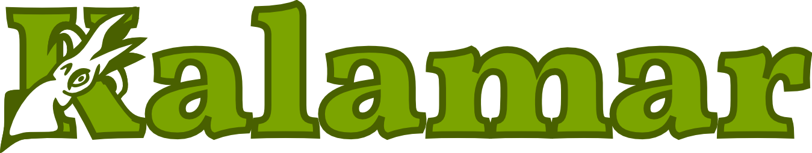
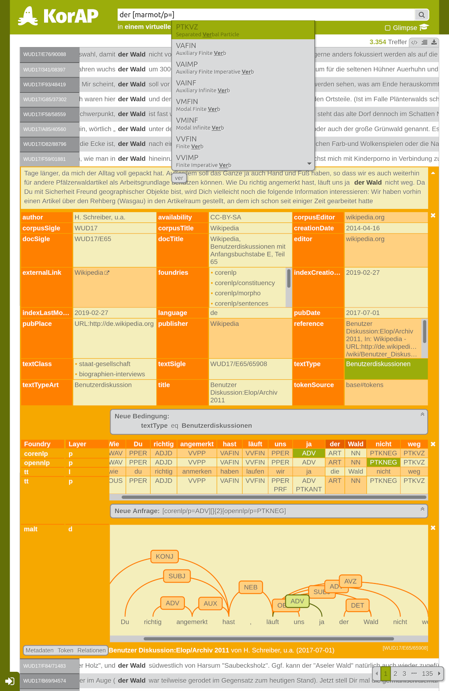

Kalamar is a [Mojolicious](http://mojolicio.us/)-based user interface
frontend for the [KorAP Corpus Analysis Platform](http://korap.ids-mannheim.de/).

[](https://zenodo.org/badge/latestdoi/36036704)



## Setup

The easiest way to install and run Kalamar is using [Docker](https://www.docker.com/).

```shell
docker pull korap/kalamar
```

Then start Kalamar listening on port `64543`.

```shell
docker run --network host --name kalamar korap/kalamar
```

Kalamar will be available at `http://localhost:64543`.

See the [description on docker hub](https://hub.docker.com/r/korap/kalamar)
regarding further information.

## Setup for Development

To install the latest version of Kalamar, first fetch the resource ...

```shell
git clone https://github.com/KorAP/Kalamar
```

... and follow the steps below.

If you have any problems with installing Kalamar,
see the *Troubleshooting* section.

Windows is not a natively supported environment for development anymore.
Please use [WSL](https://learn.microsoft.com/windows/wsl/install).

### Generate Static Asset Files

To generate the static asset files (scripts, styles, images ...),
you need NodeJS >= 6.0.0.
This will probably need administration
rights, depending on your installation path.
These tools may also be available with a package manager.

You can check your version using

```shell
npm -v
```

Afterwards you can install the dependencies and run `grunt` to create the assets.

```shell
cd Kalamar
npm install -g grunt-cli
npm install
grunt
```

Whenever the assets change, just rerun `npm install` and `grunt`.

### Start Server

Kalamar uses the [Mojolicious](http://mojolicio.us/) framework,
that expects a Perl version of at least 5.16.
An environment based on [Perlbrew](http://perlbrew.pl/) is recommended,
if available. The installation guide requires
[App::cpanminus](http://search.cpan.org/~miyagawa/App-cpanminus/) as well.

Install the dependencies using
[App::cpanminus](http://search.cpan.org/~miyagawa/App-cpanminus/)
(there is no need to install Kalamar)
and run the test suite.

```shell
cd Kalamar
cpanm --installdeps .
perl Makefile.PL
make test
```

Kalamar can be deployed like all
[Mojolicious apps](http://mojolicio.us/perldoc/Mojolicious/Guides/Cookbook#DEPLOYMENT).
The easiest way is to start the built-in server:

```shell
perl script/kalamar daemon
```

Kalamar will then be available at `localhost:3000` in your browser.

By default, Kalamar tries to connect to `https://korap.ids-mannheim.de/api/`,
followed by the most current version of the API.
You may change that endpoint to the KorAP API provider in the configuration
(see [Kustvakt](https://github.com/KorAP/Kustvakt) for further information)
or by using the environment variable `KALAMAR_API`.

If the endpoint is remote and requires SSL support, like the default endpoint,
you have to install SSL support in addition:

```
cpanm IO::Socket::SSL
```

## Updates

To update Kalamar, just run

```shell
git pull origin master
cpanm --installdeps .
npm install
grunt
```

And both the server and client dependencies should be up to date.

## Configuration

The basic configuration file is `kalamar.conf`. To define derivations,
create a configuration file with the pattern `kalamar.myconf.conf` and
follow the descriptions in `kalamar.conf`.

To start Kalamar with a derivative configuration, set the `MOJO_MODE`
environment variable.

```shell
MOJO_MODE=myconf perl script/kalamar daemon
```

For client-side configurations, a file `kalamar.conf.js` can be
introduced, that will be consulted during the build process, loading
optional components using a `require(...)` directive (see example below).

### Secret file

Kalamar uses auto rotating secrets. Allow access to a file called
`kalamar.secret.json` in the home directory of kalamar. It will
automatically be created, if it doesn't exist.
(`kalamar.secret` is deprecated.)

### Localization

To create a localized version of Kalamar, start the `localize` command
with the target locale as its argument, e.g. `pl` for polish.

```shell
perl script/kalamar localize pl
```

The newly defined dictionary file can then be modified and added to the resources
definition of the `Localize` plugin in the configuration:

```perl
Localize => {
  resources => ['kalamar.pl.dict']
}
```

To localize example queries according to a special corpus environment,
define a name of the example corpus in the configuration.

```perl
Kalamar => {
  examplecorpus => 'mycorpus'
}
```

Then create a translation file based on `kalamar.queries.dict`
as a blueprint and add it to the `Localize` resource list.

Templates can be localized and customized by overriding
the `Template` dictionary entries.

Currently the JavaScript translations are separated and stored in `dev/js/src/loc`.
To generate assets relying on different locales, add the locale to `Gruntfile.js`.

#### Annotation Helper Foundries


The annotation helper hints can be configured at runtime via configuration
file or environment variable. By default all available foundries are offered: `base`, `corenlp`,
`dereko`, `malt`, `marmot`, `opennlp`, `spacy`, `tt`, `ud`.

To **exclude** specific foundries from the defaults, prefix them with `-`:

```perl
{
  Kalamar => {
    hint_foundries => ['-spacy', '-corenlp']  # Removes spacy and corenlp
  }
}
```

```shell
KALAMAR_HINT_FOUNDRIES=-spacy,-corenlp perl script/kalamar daemon
```

To **replace** the default list entirely, specify foundries without `-` prefix:

```perl
{
  Kalamar => {
    hint_foundries => ['base', 'marmot', 'malt']  # Only these three
  }
}
```

For Docker deployments:

```shell
docker run -e KALAMAR_HINT_FOUNDRIES=-spacy korap/kalamar
```

Or mount a custom configuration file:

```shell
docker run -v /path/to/my.conf:/kalamar/kalamar.production.conf korap/kalamar
```

See `dev/js/src/hint/foundries` for available foundries.


> **Note:** For build-time customization, `kalamar.conf.js` can still
> be used to control which foundries are bundled into the JavaScript assets.

#### VC Helper Fields


The virtual corpus builder fields can be configured at runtime to add or remove
fields from the default list defined in `dev/js/src/vc/array.js`.

Use `+name:type` to **add** a field and `-name` to **remove** a field.
The result is always sorted alphabetically.

```perl
{
  Kalamar => {
    vc_helper_fields => ['+award:text', '-docTitle']
  }
}
```

```shell
KALAMAR_VC_HELPER_FIELDS=+award:text,-docTitle perl script/kalamar daemon
```

For Docker deployments:

```shell
docker run -e KALAMAR_VC_HELPER_FIELDS=+award:text,-docTitle korap/kalamar
```

#### Corpus Issues

Errors in the corpus data (e.g. metadata, tokenisation or annotation errors)
can be collected in a public GitHub repository. Enable the bundled
`CorpusIssues` plugin and set the repository URL.
The documentation gets a page `/doc/corpus/issues` that explains how to report
an error (including a note to quote only short passages for copyright
reasons) and links to the issues of the repository.

```perl
{
  Kalamar => {
    plugins => ['CorpusIssues'],
    corpus_issues => 'https://github.com/KorAP/DeReKo-Issues'
  }
}
```

```shell
KALAMAR_PLUGINS=CorpusIssues KALAMAR_CORPUS_ISSUES=https://github.com/KorAP/DeReKo-Issues perl script/kalamar daemon
```

The page is added to the documentation section with the id `corpus`
(e.g. defined in a custom `templates/doc/navigation.json` or in `navi_ext`).
If there is no such section, the plugin supplies one. Remove `CorpusIssues`
from the plugins array to disable both the page and its navigation entry.
The generated section links directly to its issue page; existing corpus pages
remain unchanged. No separate installation or instance-specific template copies
are needed.
The menu label can be changed via the dictionary entry `Nav_issues`,
the page itself via `Template_doc_corpus_issues`.


### Customization

The landing page can be customized by overriding the
entry for `Template_intro` in the dictionary.

Some sections of the user interface can be customized
by adding new
[content blocks](https://github.com/Akron/Mojolicious-Plugin-TagHelpers-ContentBlock).
Currently the documented sections are in
`footer`, in the bottom line of the user interface,
`sidebar`, in the left part of the user interface if present,
`headerButtonGroup`, in the right top part of the user interface,
and `loginInfo`, below the login form if present.

Navigation lists also expose ContentBlocks named `navigation.<realm>` and
`navigation.<realm>.<scope>` (replace scope slashes with dots), for example
`navigation.doc.corpus`. A plugin can add `<li>` elements to these blocks;
they appear after the configured entries within that section. Block positions
order plugin entries without changing the instance's navigation JSON.

### Optional downtime calendar

The bundled `Kalamar::Plugin::DowntimeCalendar` adapter can use a shared
Nextcloud ICS export to show host-specific maintenance notices in the existing
landing-page announcement area. The separate
`Mojolicious::Plugin::DowntimeCalendar` distribution (0.02+) is **not a required
Kalamar dependency** for source installations. Official Docker builds include
it by default, pinned to a full source commit from the separate Gerrit repository.
No extra container, IDS image or calendar-specific Compose overlay is needed.
The feature remains disabled until explicitly configured.

Downstream builders can omit the package entirely:

```sh
docker build --build-arg WITH_DOWNTIME_CALENDAR=0 -t my-kalamar .
```

`DOWNTIME_CALENDAR_REF` selects the pinned full commit; the Dockerfile records the
default. `DOWNTIME_CALENDAR_REPOSITORY` can point at a trusted mirror. Packages
are installed and tested during the build, never at container startup. For a
source installation, install the separate distribution in Kalamar's Perl
environment before enabling it.

Merge the adapter and calendar settings into the instance configuration:

```perl
{
  Kalamar => {
    plugins => ['DowntimeCalendar'], # preserve other configured plugins
  },
  DowntimeCalendar => {
    url => 'https://cloud.example.org/remote.php/dav/public-calendars/TOKEN?export',
    time_zone => 'Europe/Berlin',
  },
}
```

Or append `DowntimeCalendar` to `KALAMAR_PLUGINS` and set
`DOWNTIME_CALENDAR_URL`. Explicit activation requires both a URL and version
0.02 or newer of the shared package. Missing configuration, a missing package
or an incompatible version produces a clear startup error. Without activation,
Kalamar does not load the calendar or its parser dependencies.

Set `KORAP_HOSTNAME` to the physical host in Docker, e.g. through Compose's
`KORAP_HOSTNAME: "${HOSTNAME}"` with an exported `HOSTNAME` on the deployment
host. Without Docker the module discovers the local host. The calendar's
Location field contains affected hostnames/IPs, or `*` for all instances.

The box displays ongoing events and events starting within 14 days, sorted by
date. Fetches are asynchronous and cached; on a cold worker the first page
request starts the fetch and a subsequent request shows the result. Expired
notices disappear automatically. Public output contains only scheduling fields
and neutral localized text, never calendar titles, descriptions or host names.

The adapter owns the `intro.announcements` content block. English and German
intro templates render that block instead of the legacy `announcement` include
when it is registered. Otherwise the legacy include remains available. Other
applications can use the same generic Mojolicious package with their own UI.
No iframe plugin slot or instance-specific template copy is needed.

### Slim Docker images and languages

Use `sh slim_script.sh IMAGE_TAG` after building
`korap/kalamar:IMAGE_TAG-large`. CI uses the same entry point and preserves the
tag verbatim, including any `v` prefix. The script uses containerized Mint and
requires a local Docker socket at `/var/run/docker.sock`.

All installed Perl library/data directories and timezone files are retained,
including DateTime locale data, Unicode collation tables and lazily loaded
parser dependencies. The build records a SHA-256 inventory of the Perl files,
Kalamar dictionaries and JavaScript bundles. After slimming, a fresh container
must match that inventory and load every registered DateTime locale. Separate
calendar checks exercise recurrence and timezone handling when the package is
included.
Dutch, Romanian, Bulgarian and Czech have additional date-text and
collation checks. These checks preserve available language resources; they do
not add UI translations that Kalamar does not yet provide. A failed check fails
the build rather than allowing an incomplete image to be published.

### Plugins

Some plugins are bundled as part of Kalamar. Plugins can be loaded
via configuration file in an array

```perl
{
  Kalamar => {
    plugins => ['Auth']
  }
}
```

Currently bundled plugins are

- `Auth`: For integrating user management
  supported by [Kustvakt full](https://github.com/KorAP/Kustvakt/tree/master/full).
- `CorpusIssues`: For linking a corpus issue tracker; see [Corpus Issues](#corpus-issues).
- `Piwik`: For integrating [Matomo/Piwik](https://matomo.org/).
- `Tei2KorAPXML`: For integrated calls to [tei2korapxml](https://github.com/KorAP/KorAP-XML-TEI), if installed.
- `KorAPXML2Krill`: For integrated calls to [korapxml2krill](https://github.com/KorAP/KorAP-XML-Krill), if installed.
- `KrillIndexer`: For integrated calls to [Krilll](https://github.com/KorAP/Krill),
  if installed and exposed by `KRILL_INDEXER_PATH`.
- `KorAPXML2CoNLLU`: For integrated calls to [conllu2korapxml and korapxml2conllu](https://github.com/KorAP/KorAP-XML-CoNNL-U), if installed.

## Maintaining

### Caching

Kalamar supports [CHI](https://metacpan.org/dist/Mojolicious-Plugin-CHI) for caching,
allowing various cache drivers to configure.

To see options for cache maintenance
(e.g. to clear search results after index update),
run the command

```shell
perl script/kalamar chi
```

## Troubleshooting

### Problem installing Module::Pluggable

In case [Module::Pluggable](https://metacpan.org/pod/Module-Pluggable) fails
as a dependency of the [DateTime](https://metacpan.org/pod/DateTime) module,
just force the installation and ignore warnings.

```perl
cpanm --force Module::Pluggable
```


## COPYRIGHT AND LICENSE

### Original Software

Copyright (C) 2015-2026, [IDS Mannheim](https://www.ids-mannheim.de/)<br>
Author: [Nils Diewald](https://www.nils-diewald.de/), Helge Stallkamp<br>
Contributor: Uyen-Nhu Tran, Eliza Margaretha (Documentation), Susanne Feix
and Rebecca Wilm (Translation), Leo Repp

Kalamar is developed as part of the [KorAP](https://korap.ids-mannheim.de/)
Corpus Analysis Platform at the
[Leibniz Institute for the German Language (IDS)](https://www.ids-mannheim.de/),
member of the
[Leibniz Association](https://www.leibniz-gemeinschaft.de/en/home/)
and supported by the [KobRA](http://www.kobra.tu-dortmund.de) project,
funded by the
[Federal Ministry of Education and Research (BMBF)](http://www.bmbf.de/en/).

Kalamar is free software published under the
[BSD-2 License](https://opensource.org/licenses/BSD-2-Clause).

**To cite this work, please refer to:**<br>
Diewald, Nils, Barbu Mititelu, Verginica and Kupietz, Marc (2019):
[The KorAP user interface. Accessing CoRoLa via KorAP](https://www.lingv.ro/images/RRL%203%202019%2006-%20Diewald.pdf).
In: Cosma, Ruxandra/Kupietz, Marc (eds.),
On design, creation and use of of the Reference Corpus of Contemporary
Romanian and its analysis tools. CoRoLa, KorAP, DRuKoLA and EuReCo,
Revue Roumaine de Linguistique, 64(3). Editura Academiei Române,
Bucharest, Romania.

### Bundled Assets

The KorAP logo was designed by Norbert Cußler-Volz
is released under the terms of the Creative Commons
License BY-NC-ND 4.0.
[ALERTIFY.js](https://fabien-d.github.io/alertify.js/)
is released under the terms of the MIT License.
[Almond](https://github.com/jrburke/almond)
is released under the terms of the BSD License.
[dagre](https://highlightjs.org/)
is released under the terms of the MIT License.
[Highlight.js](https://highlightjs.org/)
is released under the terms of the BSD License.
[Jasmine](https://jasmine.github.io/)
is released under the terms of the MIT License.
[RequireJS](http://requirejs.org/)
is released under the terms of the BSD License.
[Font Awesome](http://fontawesome.io)
by Dave Gandy
is released under the terms of the
[SIL OFL 1.1](http://scripts.sil.org/OFL).
[Benchmark.js](https://benchmarkjs.com/)
is released under the terms of the MIT License.
[lodash](https://lodash.com/)
is released under the terms of the MIT License.
[Platform.js](https://mths.be/platform/)
is released under the terms of the MIT License.
[INTRO.JS](https://github.com/usablica/intro.js)
is released under the terms of the GNU AFFERO GENERAL
PUBLIC LICENSE (GNU AGPLv3).
